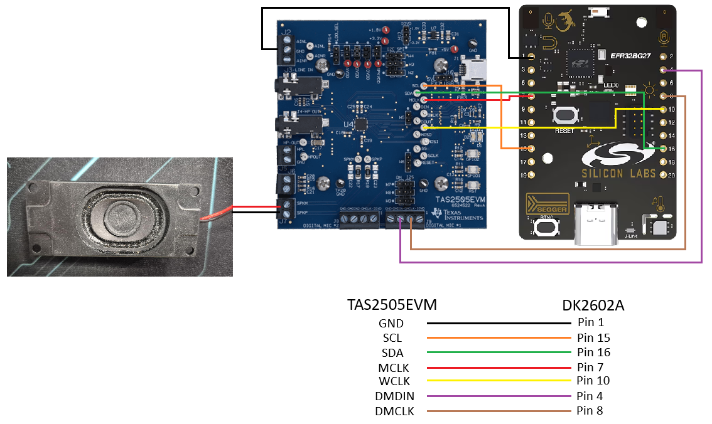

TAS2505 I2S TX (xG27)
=====================

Overview
--------

This sample plays **mono** audio (short public-domain melodies, or a 1 kHz
sine tone) on **USART0** in I2S mode and configures a TI TAS2505 codec over
I2C0 (``tas2505_init()``). The codec is always initialised; MCLK is taken
from the devicetree CLKOUT node (19.2 MHz).

``i2s_configure(channels=1)`` is used with the driver **DMASPLIT** path: the
app buffer is a plain mono stream ``[M0, M1, ...]``; the driver LDMA feeds
silence on one slot and samples on the other. ``CHANNEL_MODE`` picks which
slot carries audio.

Board overlays (``boards/xg27_rb4194a.overlay``, ``boards/xg27_dk2602a.overlay``):

* Switch ``usart0`` to ``compatible = "silabs,usart-i2s"``.
* Route I2S TX/RX/CLK to PC0/PC1/PC2 and word select (CS) to PC3 on
  ``xg27_rb4194a`` (PB2 on ``xg27_dk2602a``).
* Disable the on-board **MX25R8035F** flash, which otherwise owns USART0
  pins as SPI.
* Provide MCLK on PB0 (CMU CLKOUT2, EXPORTCLK / 4 = 19.2 MHz).
* Enable I2C0 with the TAS2505 at address ``0x18``.

The console stays on **USART1** (PA5/PA6).

Requirements
------------

* Silicon Labs EFR32xG27 board: ``xg27_rb4194a`` (BRD4194A) or
  ``xg27_dk2602a`` (BRD2602A).
* TAS2505 codec wired to the I2S, MCLK and I2C pins (or a logic analyzer for
  bench checks; codec init will log an error if the codec does not respond).

Hardware wiring
---------------

The figure below shows the sample wired between a **TAS2505EVM** codec board
and an **xG27-DK2602A** (BRD2602A) board, with a speaker connected to the
EVM speaker output (``SPKP``/``SPKM``). Pin numbers on the DK2602A refer to
its expansion header (EXP).

   TAS2505EVM to xG27-DK2602A wiring (wire colours match the table below).

.. list-table::
   :header-rows: 1
   :widths: 15 15 15 25 30

   * - Signal
     - TAS2505EVM
     - DK2602A (EXP)
     - Wire colour
     - Function
   * - GND
     - GND
     - Pin 1
     - Black
     - Common ground.
   * - SCL
     - SCL
     - Pin 15
     - Orange
     - I2C0 clock (codec control, address ``0x18``).
   * - SDA
     - SDA
     - Pin 16
     - Green
     - I2C0 data (codec control).
   * - MCLK
     - MCLK
     - Pin 7
     - Red
     - 19.2 MHz master clock (PB0, CMU CLKOUT2).
   * - WCLK
     - WCLK
     - Pin 10
     - Yellow
     - I2S word select / LRCLK.
   * - DMDIN
     - DMDIN (J9)
     - Pin 4
     - Purple
     - I2S serial data from the xG27 (USART0 TX, PC0).
   * - DMCLK
     - DMCLK (J9)
     - Pin 8
     - Brown
     - I2S bit clock / BCLK (USART0 CLK, PC2).

Notes:

* The speaker is wired to the ``SPKP``/``SPKM`` terminals of the TAS2505EVM
  (red wire to ``SPKP``, black wire to ``SPKM``).
* The TAS2505EVM is powered separately (USB) in the diagram; keep the grounds
  of both boards common through the GND wire.
* The EXP pin assignments above come from the diagram. If you change the
  pins, update ``boards/xg27_dk2602a.overlay`` accordingly.

Build options
-------------

Pass with ``west build ... -- -D<name>=<value>``:

.. list-table::
   :header-rows: 1
   :widths: 20 15 65

   * - Variable
     - Default
     - Description
   * - ``AUDIO_SOURCE``
     - ``short_songs``
     - ``short_songs``: runtime melodies; ``sine1khz``: pure 1 kHz tone
       (``FRAME_CLK_HZ`` must be 8000, 16000, 44100 or 48000).
   * - ``FRAME_CLK_HZ``
     - ``16000``
     - I2S frame (sample) clock, Hz.
   * - ``WORD_SIZE``
     - ``16``
     - ``16`` (``W16D16``) or ``32`` (``W32D16``: 16-bit sample in the low half
       of each 32-bit slot via ``SAMPLE_EXPAND`` in ``src/main.c``).
       Any other value aborts CMake.
   * - ``CHANNEL_MODE``
     - ``mono_right``
     - ``mono_right``: audio in right slot, left silent. ``mono_left``: audio
       in left slot, right silent (applies ``boards/mono_left.overlay``,
       ``silabs,mono-tx-slot = "left"``).
   * - ``PLAYBACK_MODE``
     - ``one_shot``
     - ``one_shot``: play once, drain, then ``i2s_configure(off)`` gates
       BCLK/LRCLK. ``loopback``: replay forever, clocks never stop.

Stereo is not supported by this sample. With ``WORD_SIZE=16`` and
``SAMPLES_PER_BLOCK=256`` each TX block is 512 B (32-bit: 1024 B); 8 blocks
are allocated from ``tx_slab``.

Building and running
--------------------

Run from your west workspace; keep build output outside the source tree with
``-d``. Replace ``<path>`` with the location of this repository.

.. code-block:: shell

   # Default: short songs, 16 kHz, 16-bit, right slot, play once
   west build -p always -b xg27_rb4194a <path>/samples/tas2505 -d build/tas2505
   west flash -d build/tas2505

   # DK2602A, left slot, 32-bit slots, 48 kHz, loop forever
   west build -p always -b xg27_dk2602a <path>/samples/tas2505 -d build/tas2505_dk -- \
       -DCHANNEL_MODE=mono_left -DWORD_SIZE=32 -DFRAME_CLK_HZ=48000 -DPLAYBACK_MODE=loopback

   # 1 kHz sine at 16 kHz, looped (clock / amplifier validation)
   west build -p always -b xg27_dk2602a <path>/samples/tas2505 -d build/tas2505_sine -- \
       -DAUDIO_SOURCE=sine1khz -DFRAME_CLK_HZ=16000 -DPLAYBACK_MODE=loopback

If HAL modules are missing, run ``west update hal_silabs cmsis cmsis_6`` (or a
full ``west update``) once.

1 kHz sine source
~~~~~~~~~~~~~~~~~

``AUDIO_SOURCE=sine1khz`` plays a pre-quantized, loop-clean 1 kHz clip at
-6 dBFS from ``src/audio_sine/``. CMake links exactly one ``sine_<rate>.c``
(8k, 16k, 44k or 48k) matching ``FRAME_CLK_HZ``; ``audio_sine.c`` reads the
``int16_t`` or ``int32_t`` mono array according to ``WORD_SIZE``.
``PLAYBACK_MODE=loopback`` is recommended for scope / FFT captures.

Regenerate the clips (optional) with:

.. code-block:: shell

   python3 src/tools/gen_sine_pcm.py                 # all rates, -6 dBFS
   python3 src/tools/gen_sine_pcm.py --fs 44100 --level -12 --cycles 200

Optional embedded PCM (not used by default)
~~~~~~~~~~~~~~~~~~~~~~~~~~~~~~~~~~~~~~~~~~~

``src/tools/gen_song_mp3.py`` can generate ``src/song_pcm.c`` from an audio
file, but this sample does **not** link embedded PCM: CMake only supports
``short_songs`` and ``sine1khz``. Keep the script for manual experiments if
you add ``song_pcm.c``, ``audio_pcm.c``, and an ``AUDIO_SOURCE=pcm`` build
path locally.

Expected on the bench
~~~~~~~~~~~~~~~~~~~~~

* BCLK = ``Fs x 2 x slot_bits`` (16 kHz / 16-bit: 512 kHz; 48 kHz / 32-bit:
  3.072 MHz); LRCLK = ``FRAME_CLK_HZ``, 50 % duty.
* MCLK = 19.2 MHz on PB0 (EXP7).
* Sine: steady 1 kHz tone without clicks.

Runtime
-------

Serial console: 115200 8N1 on USART1. At startup the sample logs its
configuration, then:

* ``one_shot``: streams blocks until the source reports done, triggers
  ``I2S_TRIGGER_DRAIN``, waits for the queue to clock out, then calls
  ``i2s_configure()`` with an empty config, which stops the USART and gates
  BCLK/LRCLK. The app then sleeps forever.
* ``loopback``: the source wraps to the start and ``main.c`` writes blocks
  forever; no drain or gating occurs.

Example (one_shot)::

   sample start board=xg27_rb4194a audio=short_songs channels=mono_right i2s_ch=1 playback=one_shot FRAME_CLK_HZ=16000 WORD_SIZE=16 block=512
   i2s_configure ok
   TAS2505 MCLK from DT: 19200000 Hz
   pre-roll queued: 0 silent blocks
   I2S START @ 16000 Hz
   audio source reports done; queuing 0 silent tail blocks
   draining (~228 ms)...
   I2S stopped; BCLK/LRCLK gated. Probe pins to confirm: DIN/BCLK/LRCLK should be idle.
